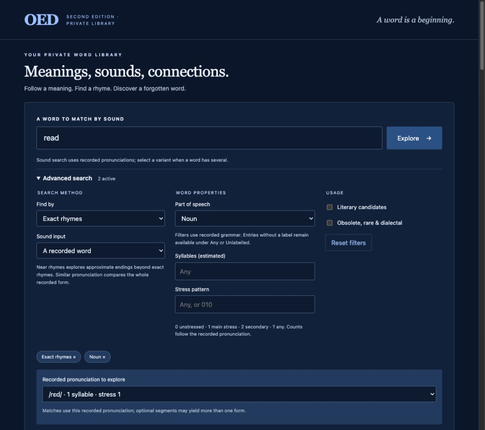
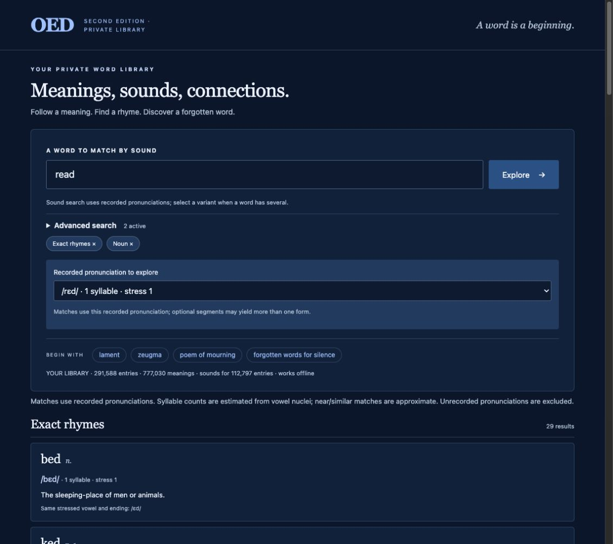

# OED word explorer

A private, standalone research server for the supplied Oxford English Dictionary
Second Edition disc. Runs offline on modern Python with no third-party Python
packages, Windows installation, CD mount, or external AI service after import.

## Screenshots





## Getting started

Requires Python 3.10 or newer with SQLite FTS5. Tested with Python 3.14.5.
No third-party Python packages are required. Clone this repository and change
into its directory:

```sh
git clone https://github.com/juangrukat/oed-word-explorer.git
cd oed-word-explorer
```

This repository contains application code and import tools, **not the dictionary
corpus or disc image**. Import your own matching OED Second Edition disc using
the instructions below, then build the pronunciation index:

```sh
python3 -m oed.advanced
python3 -m oed.server
```

Open http://127.0.0.1:8765. Stop the server with Ctrl+C.
On macOS, you can also double-click `Start OED.command`.

If you already have an imported installation, copy its entire `data` directory
into this checkout and run `python3 -m oed.server`. To move the standalone server
to another computer, copy the `oed`, `web`, and `data` directories together and
run the same command from their parent directory. After import, the original
ISO, CD mount, Windows software, and internet connection are unnecessary.
Python and the imported local data files are still required; this is a standalone
server rather than a bundled executable.

For a trusted private network, bind explicitly:

```sh
python3 -m oed.server --host 0.0.0.0 --port 8765
```

Open `http://<server-private-IP>:8765` from another device. This configuration
has no account system and is intended for your trusted private network.

## Explore words

- **Headwords:** search words, grouped variants, and named subentries. Use `*`
  for any sequence and `?` for one character. Stress marks and accents are
  normalized for lookup while the original display forms are retained.
- **Definitions / ideas:** reverse search such as `poem mourning`, `rhetorical
  repetition`, or `grief sorrow`. Multiword ideas can be expanded from cited
  dictionary definitions. Supporting definitions are shown when the concepts
  occur in different senses of an entry. Ranking uses indexed word stems and
  does not understand every modern paraphrase.
- **Historical quotations:** search the separate quotation index. Quotations
  are excluded from definition similarity so incidental mentions do not drive
  word connections.
- **Literary connections:** filter candidate senses identified by literary
  definition terms or usage labels, including abbreviated rhetoric labels.
- **Obsolete, rare & dialectal:** filter by explicit historical dictionary
  status/usage labels and concise leading definition labels. This is not a
  measure of how uncommon a word is today.
- **Choose a sense:** connections update for the selected meaning. Explicit
  references, subentries, inferred similarities, and incoming references are
  presented separately. Inferred suggestions name the shared definition terms.
- **Inspect evidence:** read definitions, etymology, quotations, full references,
  and the original SGML. Entry URLs bookmark the selected sense and search.

Ambiguous reference targets are offered as choices. The original reference's
sense number remains visible; the server does not silently claim a perfect
sense-number match across homonyms. Incoming links can refer to another sense
or homonym. Similarity is a discovery aid, not a verified synonym or antonym.

## Rebuild from the disc

The extraction tool accepts the checksum-matched database investigated here.
Mount your ISO read-only (the macOS example assumes it mounts at `/Volumes/OED2`), then:

```sh
python3 research/extract_database.py /Volumes/OED2/OED2.DAT --output data
python3 -m oed.importer
```

Extraction is bounds checked and checks the continuity of logical block
positions. Full blocks may end before the historical decoder's six-zero
terminator; only a complete code or all-zero remaining prefix is accepted.
The importer verifies the corpus checksum, opening/closing record counts,
coverage outside records, SQLite integrity, foreign keys, and both FTS indexes.
It writes its database to a temporary file and replaces the serving database
only after validation. Extraction similarly writes a partial file first.

`data/extraction.json` records every block's disc/corpus offsets and the recovered
corpus digest. `data/import-report.json` records counts, parsing issues, and
unmapped entities. Each entry retains its byte offset, length, and digest.
The database and corpus must travel together; startup checks their identity.

Run the tests:

```sh
python3 -m unittest discover -s tests -v
```

## HTTP API

All endpoints are read-only; responses are JSON except original markup.

| Endpoint | Parameters |
| --- | --- |
| `/api/status` | None |
| `/api/search` | `q`, `mode=headword/definitions/quotations`, `literary=1`, `obscure=1` |
| `/api/entry` | `id` (source byte offset) |
| `/api/related` | `id`, optional `sense`, `literary=1`, `obscure=1` |
| `/api/quotations` | `id`, `offset` (pages of 40) |
| `/api/raw` | `id` |

## Sources and limits

Investigation: [research/findings.md](research/findings.md). The database identity
matches the [historical decoder documentation](https://9p.io/sources/contrib/tristan/oed/README).
The bounded decoder follows the algorithm described in
[decompress.c](https://9p.io/sources/contrib/tristan/oed/decompress.c), correcting
its unsafe memory boundary behavior. Character, pronunciation, Greek, and tag
interpretations are informed by the Plan 9
[OED reader](https://9p.io/sources/plan9/sys/src/cmd/dict/oed.c) and
[character utilities](https://9p.io/sources/plan9/sys/src/cmd/dict/utils.c).
Their upstream notices are preserved in `research/plan9-license.html` and
`THIRD_PARTY_NOTICES.md`.

Unknown special characters remain visibly marked as `⟦&name.⟧`, and original
SGML remains available. Some character mappings in the historical reader are
approximations, especially specialist symbols. Sense numbering, subentries, and
all source text are retained; this interface does not reproduce every original
typographic layout or claim equivalence with the old application's runtime.
No separate curated thesaurus dataset was established. Relationships beyond
explicit references/editorial grouping use transparent text similarity. No
embeddings, AI-generated synonyms, or cloud calls are used.

The imported dictionary content is kept separate from application code. This
project does not publish or distribute your dictionary data.

## Advanced Search

Open **Advanced search** below the main field. Choose a search method and optional
part-of-speech, literary, and historical-usage filters. Active filters remain
visible when the panel is closed; result links preserve the search settings.

- **Exact rhymes:** match the final recorded main-stressed vowel and following
  phonemes. A single vowel nucleus is sufficient for monosyllables. Unstressed
  multisyllabic forms do not receive invented main stress.
- **Near rhymes:** compare approximate rhyming endings, excluding exact endings
  so they do not crowd out near matches.
- **Similar pronunciation:** compare the complete pronunciation, including
  homophones. Approximate rankings use phoneme edit distance with lower costs
  for related sound classes; they are research aids, not acoustic measurements.
- **Pronunciation choice:** when a headword has multiple usable recorded forms,
  select one before searching. `read` can lead to different results for /riːd/
  and /rɛd/. Choose **IPA pronunciation** to enter validated IPA directly.
- **Syllables and stress:** counts are estimated from vowel nuclei. Stress uses
  `0` for unstressed, `1` for main stress, `2` for secondary stress, and `?` for
  any one syllable. For example `10` selects a two-syllable initial-stress form.
- **Part of speech:** uses explicitly recorded classes. Subentries use their own
  grammar rather than their parent's. Mixed classes can match either stated
  class; unknown classes remain under **Any** or **Unlabelled grammar**.

The first sound index covers 112,797 entries with 134,203 validated forms.
Missing or partial pronunciations, prose notes and unresolved legacy symbols (including
unconverted capital `R`) are excluded rather than guessed. Optional recorded
segments are expanded as explicit variants. Source texts remain unchanged.
The underlying OED2 pronunciations reflect its historical edition and convention;
see the publisher's [second-edition pronunciation key](https://www.oupjapan.co.jp/sites/default/files/contents/dictionaries/oed/help/pronunciation-2e.html).

The auxiliary `data/advanced.sqlite` index must accompany the original database
and corpus when moving the server. To recreate it after a dictionary import:

```sh
python3 -m oed.advanced
```

It is built atomically, independently of the dictionary database. The index
report is `data/advanced.json`. Search API additionally accepts `mode=rhyme`,
`near-rhyme`, or `sounds-like`; `pos`; `syllables`; `stress`; `input=word/ipa`;
and a chosen `pronunciation` key returned by the API. Sound similarity uses a
bounded set of the nearest indexed pronunciation keys (up to 800 keys within
edit cost 2.05). Tight filters can therefore produce fewer approximate results;
exact rhyme lookup uses its complete indexed ending group before the display cap.
